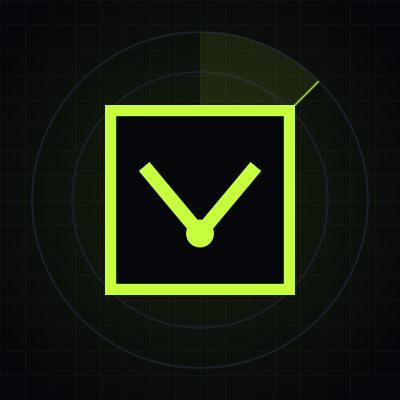

<p align="center">
  
</p>

# Trenchwatch

**Real-time launch-risk alerts for Solana launchpads, with the on-chain evidence behind every alert.**

Every day, around 41,700 tokens launch on Solana's major launchpads. A meaningful share come from repeat creators, and their early demand often arrives within the first seconds. Trenchwatch reads every new launch on five major Solana launchpads as it happens and sends platforms an alert, with the on-chain evidence, within seconds. Platforms decide what to do with it: label a token, warn users before they buy, or review a listing.

> This repository is the public overview of Trenchwatch: what it does, how to integrate it and how to work with us. The detection engine is proprietary and is not published here.

---

## At a glance

| | |
| --- | --- |
| Launchpads covered live | **5** major Solana launchpads (full coverage list available on request) |
| Token launches read | **1,127,107** (about 41,700 a day) |
| Early purchases read (first 15 s) | **9,506,316** (about 388,000 a day) |
| Median time from launch to alert | **2.3 s** |
| Daily data library | **33 days** archived, growing every day |

*Figures as of 17 November 2026. Live figures, updated every five minutes, at [trenchwatch.dev](https://trenchwatch.dev).*

## What it does

1. **Read:** every new launch on the covered launchpads, and the purchases in its first seconds.
2. **Recognise:** whether the creator and the early buyers match addresses already seen in repeat launches.
3. **Alert:** by Telegram, email or a signed webhook, within seconds of the launch.
4. **Evidence:** every alert carries the on-chain transactions behind it, ready for review.

```
Token launches on-chain  →  Trenchwatch reads it  →  Matched to known addresses  →  Alert with evidence
```

Clients receive the alert, an evidence level, a stable ID for the address group and the on-chain evidence. The detection method stays private.

## What an alert looks like

*(Sandbox example, synthetic data. Field names follow the v1 standard.)*

```json
{
  "api_version": "2026-10",
  "id": "A-20261015-000001",
  "type": "operator_launch",
  "level": "RELATED",
  "detected_at_utc": "2026-10-15 01:00:03",
  "token": "<mint>",
  "operator": {"id": "TW-9001", "address": "<address>"},
  "summary": "Address group TW-9001, already seen in repeat launches, created a new token.",
  "evidence": [{"step": "create", "transaction": "<signature>"}],
  "transaction": "<signature>",
  "sandbox": true
}
```

Alerts follow **Solana Launch Alerts**, an open, MIT-licensed standard for launch-risk alerts that we maintain, with SDKs for TypeScript and Python.

## Integration

| Channel | For | Notes |
| --- | --- | --- |
| Telegram and email | Trust and safety teams | Live from day one, no engineering needed |
| Signed webhooks | Your systems | HMAC-SHA256, replay protection, automatic retries |
| REST API | Products and dashboards | Token risk, address role, latest alerts |
| Sandbox | Evaluation | Synthetic data and test keys, same shapes as production |

- **[API documentation](docs/api/README.md)**
- **[OpenAPI specification](docs/api/openapi.yaml)**

Sandbox: `https://sandbox-api.trenchwatch.dev/v1/health` (synthetic data; test keys on request at info@trenchwatch.dev).

## Who it is for

| Who | What they get |
| --- | --- |
| Launchpads | Early context on repeat creators using the platform |
| Wallets | Context to show users before they buy |
| Trading terminals | A label next to every new token |
| Security and analytics teams | A live feed and a daily data library for Solana launches |

## Principles

- **Public data only.** Every input comes from the public Solana ledger.
- **Addresses, not people.** We describe addresses and on-chain patterns, never individuals.
- **The platform decides.** We provide context and evidence; each platform chooses what to do with it.
- **Client data stays private.** Each client sees only its own alerts and reports.
- **No trading on our own alerts.** Trenchwatch does not trade on its signals.

Alerts are probabilistic observations, not financial advice.

## Work with us

- **Platforms:** alerts and API for your launchpad, wallet or terminal.
- **Data:** a daily library of Solana launch data, delivered with a delay, and closed historical months.
- **Partners:** security and analytics teams that want to integrate the feed into their products.

**Contact:** [info@trenchwatch.dev](mailto:info@trenchwatch.dev) · X: [@TrenchwatchTech](https://x.com/TrenchwatchTech) · Web: [trenchwatch.dev](https://trenchwatch.dev)

---

## Author

Built by **Ivan Alonso**, founder of EMERGE and software architect of Trenchwatch.
[LinkedIn](https://www.linkedin.com/in/ivanalonsodev) · [X](https://x.com/ivanalonsodev)

---

Trenchwatch is a product of **EMERGE**. © 2026 EMERGE. All rights reserved. See [NOTICE](NOTICE).
